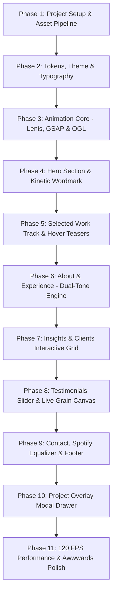

# Melon Studio Exact Replica — Master Implementation Plan

> **Benchmark:** Award-winning SOTD (Site of the Day) on Awwwards / FWA / CSS Design Awards  
> **Source Target:** [https://melon.studio/](https://melon.studio/)  
> **Target Experience:** 120 FPS buttery smooth kinetic typography, OGL WebGL fluid shaders, Lenis inertial scrolling, dual-tone reactive interface, and pixel-identical Polish design studio aesthetics.

---

## 1. Executive Summary & Aesthetic Taste

**Melon Studio** (Piotr Brzeziński, Poznań, Poland) represents the pinnacle of modern European digital craftsmanship. It blends hyper-minimalist typography with organic WebGL motion, warm off-white and obsidian contrast palettes, and micro-interactions that feel tangible.

### Core Visual Principles
- **Monochrome with Surgical Color Hits:** Deep obsidian (`#0f0000`) and warm alabaster (`#f6efed`), energized by signature neon coral red (`#e5524a` / `--red-3`), liquid pink (`#ffb3b3`), and cyan/teal gradients (`#45e0ea` → `#1497ac`).
- **Dual-Tone Inversion (`data-tone`):** Sections cleanly alternate between `data-tone="white"` and `data-tone="black"`. The navigation bar and floating elements automatically invert colors and blend modes (`--f-inv`, `.is-blend`) as scroll boundaries are crossed.
- **Editorial Type Scale:** Giant display headings (`clamp(4rem, 12vw, 11rem)` with `-0.05em` tracking) paired with monospace technical indicators (`Geist Mono`, 13px) and humanist body copy (`Early Sans Variable`).
- **Tangible Kinetic Physics:** No generic CSS transitions. Every motion is governed by custom cubic-bezier curves (`cubic-bezier(.11, .06, .18, 1)` and `cubic-bezier(.18, .66, .18, 1)`), GSAP ScrollTrigger scrubbed timelines, and OGL fluid shaders.

---

## 2. In-Depth Tech Stack Architecture & Rationales

To achieve a true **1:1 award-winning replica**, our stack mirrors Melon Studio’s exact modern architecture while ensuring zero lag, instant SSR hydration, and fluid 120fps rendering.

```
┌────────────────────────────────────────────────────────────────────────┐
│                          NEXT.JS 15 (APP ROUTER)                       │
│           React 19 Server & Client Components + Turbopack               │
├──────────────────────────────────┬─────────────────────────────────────┤
│        ANIMATION & MOTION        │            GRAPHICS & GL            │
│  • GSAP 3.12 (ScrollTrigger)     │  • OGL (Lightweight WebGL 2)        │
│  • @studio-freight/lenis (1.1)   │  • GLSL Shaders (FBM Fluid & Heat)  │
│  • Custom Spring / RAF Dispatch  │  • 2D Procedural Noise Grain Canvas │
├──────────────────────────────────┴─────────────────────────────────────┤
│                          STYLING & FOUNDATION                          │
│  • Tailwind CSS v4 + Native CSS Custom Properties (OKLCH / LAB)       │
│  • Adobe Typekit Webfonts (Early Sans Variable, Lekick Regular)        │
│  • Lucide Icons + Custom Clean Studio SVGs                             │
└────────────────────────────────────────────────────────────────────────┘
```

### Detailed Tech Stack Comparison & Decisions

| Layer | Chosen Technology | Why Not Alternatives? |
|---|---|---|
| **Core Framework** | **Next.js 15 (App Router, React 19, TypeScript)** | Next.js matches Melon Studio's actual production architecture (`/_next/static/immutable/...`). It offers zero-CLS layout rendering, instant image/font optimization, route-intercepted modal drawers for projects (`/work/[slug]`), and blazing Turbopack HMR. |
| **Smooth Scroll Engine** | **@studio-freight/lenis** (v1.1+) | Lenis is the industry gold standard for SOTD sites. Native browser scrolling is jagged; Locomotive Scroll is heavy and hijacks scroll position unnaturally. Lenis preserves native wheel and touch physics with customizable damping (`lerp: 0.08`), perfectly bridging DOM and WebGL coordinates. |
| **Timeline & Interaction Engine** | **GSAP 3.12 (Core, ScrollTrigger, Flip)** | Framer Motion is great for simple React components but lacks the sub-millisecond precision, scrubbing, batching, and custom ticker integration required for multi-section pinned scroll tracks and letter-split masking. GSAP context handles clean teardown on navigation. |
| **WebGL & Shaders** | **OGL (Minimal WebGL Library)** | Three.js is ~600KB and designed for 3D meshes/scenes. Melon Studio uses lightweight OGL (~10KB) for 2D quad screen-space shaders: the organic red ink/heat page wipe, the interactive hero silhouette gradient, and the review section grain. OGL gives direct access to WebGL 2 contexts with zero overhead. |
| **CSS & Design Tokens** | **Tailwind CSS v4 + Raw CSS Variables (`OKLCH`/`LAB`)** | Modern CSS custom properties support perceptual color spaces (`oklch(from var(--ink) l c h / .55)`) that make dark/light transitions vibrant without muddy grey artifacts. Tailwind v4 brings instant compilation and seamless token injection. |
| **Typography** | **Early Sans Variable + Lekick Regular + Geist Mono** | Loaded directly via Adobe Typekit (`https://use.typekit.net/omg1nuw.css`) with local fallback metrics to eliminate layout shift completely. |

---

## 3. The "Buttery Smooth" Animation System

Achieving Melon Studio’s exact feel requires planning and coordinating 10 distinct animation subsystems:

### 3.1. Unified RAF Heartbeat (Lenis + GSAP Ticker Integration)
To prevent scroll jitter, GSAP and Lenis must run on a single synchronized render loop:
```typescript
// Smooth scroll & GSAP ticker bridge
const lenis = new Lenis({
  lerp: 0.085,
  wheelMultiplier: 0.9,
  smoothWheel: true,
  touchMultiplier: 1.5,
});

lenis.on('scroll', ScrollTrigger.update);

gsap.ticker.add((time) => {
  lenis.raf(time * 1000);
});
gsap.ticker.lagSmoothing(0);
```

### 3.2. Hero 5-Letter Wordmark Split & Scrubbed Parallax
- **The Asset:** SVG Wordmark with viewBox `0 0 1920 622` containing 5 paths (`m`, `e`, `l`, `o`, `n`).
- **The Technique:** The client JavaScript dynamically queries the bounding box of each SVG letter path, generates separate `.f-wm__l` (cyan gradient) and `.f-sil__l` (crimson silhouette gradient) clipped layers with CSS `-webkit-mask`.
- **The Scrub:** As the user scrolls through the hero:
  - Letter `m`: `translate3d(-4vw, calc(var(--hero-y) * 1.2), 0)`
  - Letter `e`: `translate3d(-1.5vw, calc(var(--hero-y) * 0.9), 0)`
  - Letter `l`: `translate3d(0, calc(var(--hero-y) * 1.5), 0)`
  - Letter `o`: `translate3d(1.8vw, calc(var(--hero-y) * 0.8), 0)`
  - Letter `n`: `translate3d(4.2vw, calc(var(--hero-y) * 1.3), 0)`
- **Entrance Animation:** Fast cascade reveal using `--appear-ease: cubic-bezier(.11, .06, .18, 1)`.

### 3.3. OGL Organic Heat / Ink Bleed Transition Shader
- A custom GLSL shader running on a full-screen canvas.
- **Uniforms:**
  - `uniform vec2 u_res;` — Canvas resolution
  - `uniform vec2 u_o;` — Interaction origin coordinate
  - `uniform float u_r;` — Expanding wavefront radius
  - `uniform float u_heat;` — Crimson heat intensity (0 to 1)
  - `uniform float u_mode;` — 0: Cover / 1: Uncover
  - `uniform float u_warp, u_spray, u_tail, u_core;` — Fractional Brownian Motion turbulence
- Creates the organic crimson ink-spray wavefront during page transitions and project previews.

### 3.4. Vertical Work Track with Floating Pinned Captions (`cap-pin`)
- Projects are rendered in `#track` with `.proj` cards (`aspect-ratio: 16/9`, width `var(--col-w)`).
- On desktop, captions (`.proj__cap`) stay aligned to the project or detach into fixed position with `will-change: transform`, smoothly translating with spring physics to track the currently centered project.
- Card hover triggers a subtle 3D perspective tilt (`perspective: 1000px`, `rotateX`, `rotateY`) and smooth video teaser playback (`data-video`).

### 3.5. Dual-Deck Text Roll (`.f-roll`) & Directional Sliding Arrows
- Buttons and links like "Show all", "More about me", and "Start a project" utilize a dual-layer rolling span:
```html
<span class="f-roll">
  <span class="f-roll__in">
    <span class="f-roll__t">Show all</span>
    <span class="f-roll__t f-roll__t--b" aria-hidden="true">Show all</span>
  </span>
</span>
```
- On hover, `.f-roll__t` translates `translateY(-100%)` with cubic easing, bringing the bottom twin into view.
- The arrow icons (`.f-showall__arr`) animate out right (`translateX(150%)`), while `.f-showall__arr--b` enters seamlessly from the left (`translateX(0)`).

### 3.6. Topbar Dynamic Inversion & Directional Smart Hide
- **Tone Inversion:** `ScrollTrigger.create` tracks sections with `data-tone="white"` vs `data-tone="black"`. When entering light sections, the topbar triggers `.is-blend`, instantly flipping ink colors or applying CSS `mix-blend-mode: difference`.
- **Directional Hide/Show:**
  - Scrolling down past 200px: `gsap.to(topbar, { y: -80, duration: 0.3, ease: 'power2.out' })`
  - Scrolling up even 5px: `gsap.to(topbar, { y: 0, duration: 0.35, ease: 'power2.out' })`

### 3.7. Testimonials Carousel with Synchronized Paging
- Review cards slide horizontally with GSAP flip/fade.
- Indicator counter smoothly transitions (`01 / 03` → `02 / 03`).
- In the background, `.f-kw-grain canvas` renders an active procedural noise film grain that dynamically shifts, giving a velvet analog texture.

### 3.8. Live Interactive Audio Equalizer (`.f-eq`)
- In the Contact footer: "Listening & Reading" connects to Spotify track.
- 4 red vertical bars with staggered CSS keyframe animations (`0.9s`, `0.62s`, `1.1s`, `0.74s`) alternating scaleY from `0.2` to `1.0`.

### 3.9. Pull-Down Project Modal Overlay (`#overlay`)
- Clicking any project opens the detail drawer without full page reload.
- Custom touch/wheel pull-down gesture to dismiss.
- Circular SVG progress ring (`.ov-pull__ring`) fills smoothly as the user pulls down, snapping shut when threshold (80px) is reached.

---

## 4. Master Data Registry & Content Structure

To build an exact replica, all content from Melon Studio is pre-cataloged:

### 4.1. The 7 Featured Projects
1. **Mastercard Music** (`mastercard-music`) — Product design, 2025
   - Image: `/media/projects/mastercard-music/thumbnail.webp`
   - Video: `mastercard-music.74b4874e`
2. **All Aces Games** (`allaces-games`) — Brand and website, 2026
   - Image: `/media/projects/allaces-games/thumbnail.webp`
   - Video: `allaces-games.798ce7ca`
3. **oneDynamics** (`onedynamics`) — Company website, 2026
   - Image: `/media/projects/onedynamics/thumbnail.webp`
   - Video: `onedynamics.5d1013f1`
4. **Sawicki Legal** (`sawicki-legal`) — Law firm website, 2025
   - Image: `/media/projects/sawicki-legal/thumbnail.webp`
   - Video: `sawicki-legal.3a81741e`
5. **Huuuge Games** (`huuuge-games`) — Games website, 2024
   - Image: `/media/projects/huuuge-games/thumbnail.webp`
   - Video: `huuuge-games.d28103a2`
6. **Interact** (`ipg-interact`) — Redesign concept, 2025
   - Image: `/media/projects/ipg-interact/thumbnail.webp`
   - Video: `ipg-interact.2a67d51b`
7. **HiProMine** (`hipromine`) — Home page design, 2025
   - Image: `/media/projects/hipromine/thumbnail.webp`
   - Video: `hipromine.73532c7e`

### 4.2. Experience Timeline
- **Kinesso** — Product Designer (2024 – Present)
- **Webmetric** — UX/UI Designer (2023 – Present)
- **Froggly** — UI Designer (2023 – 2024)
- **GPD Agency & Film Studio** — Senior Graphic Designer & UX/UI Designer (2018 – 2023)
- **Pit Bull West Coast** — Graphic Designer (2016 – 2018)

### 4.3. Insights & Articles
- "Redefining Navigation for Interact SaaS" (Product design · 3 min read)
- "Stable Diffusion 3 vs Midjourney and Dall·E 3" (AI · 3 min read)
- "WebGPU: The future of web applications." (Web design · Quick read)
- "Discover New Music with Spotify’s Smart Shuffle ✨" (AI · 2 min read)
- "Valentine’s Matchmaker" (Product design · 3 min read)

### 4.4. Client Logos (Full Vector SVG Suite)
Mastercard, Poczta Polska, PKP, Enea, All Aces, Kinderkraft, Barter, Webmetric, oneDynamics, GPD Agency, OneDayMore, SEOHost, Bayer, Lidl, Omnicom, Stagwell, Tenzi.

---

## 5. Step-by-Step Implementation Roadmap



### Phase 1: Project Scaffolding & Asset Pipeline
- **Task 1.1:** Initialize Next.js 15 project with TypeScript, React 19, Tailwind CSS v4, and App Router.
- **Task 1.2:** Install core dependencies: `gsap`, `@studio-freight/lenis`, `ogl`, `lucide-react`, `clsx`, `tailwind-merge`.
- **Task 1.3:** Mirror all original media assets from `https://melon.studio/` to `/public/` (`/public/brand/`, `/public/media/projects/`, `/public/media/logos/`, `/public/media/posts/`).

### Phase 2: Design Token System, Typography & Global Styles
- **Task 2.1:** Create `src/styles/tokens.css` with exact variables extracted from Melon Studio:
  - `--black: #0f0000;`, `--white: #f6efed;`, `--red-3: #e5524a;`, `--liquid-pink: #ffb3b3;`
  - `--font: 'early-sans-variable', sans-serif;`, `--font-display: 'lekick-regular', sans-serif;`, `--font-mono: 'Geist Mono', monospace;`
  - Custom clamp utilities (`--f-title-size`, `--st-gap`, `--atf-hero`, `--col-w`).
- **Task 2.2:** Configure Typekit webfont link and font-face fallbacks in root `layout.tsx`.
- **Task 2.3:** Implement global dual-tone classes (`[data-tone="white"]`, `[data-tone="black"]`).

### Phase 3: Animation Core (Lenis Smooth Scroll + GSAP Ticker)
- **Task 3.1:** Create `src/components/providers/SmoothScrollProvider.tsx` wrapping Lenis with GSAP ScrollTrigger ticker integration.
- **Task 3.2:** Build custom hook `useScrollVelocity` and reactive tone observer for topbar inversion.
- **Task 3.3:** Scaffold OGL shader canvas base component `src/components/canvas/FluidShaderCanvas.tsx`.

### Phase 4: Topbar & Hero Section with Letter-Mask Wordmark
- **Task 4.1:** Build `src/components/navigation/Topbar.tsx`:
  - Melon studio logo, navigation links (`work (7)`, `articles (7)`, `about`, `contact`).
  - Dual-layer text roll hover (`.f-roll`).
  - Directional auto-hide on downward scroll, reveal on upward scroll.
  - Section-tone observer that toggles `.is-blend`.
- **Task 4.2:** Build `src/components/sections/Hero.tsx`:
  - Full-height viewport container with obsidian gradient background.
  - SVG Wordmark with 5 independent letter masks (`M-E-L-O-N`).
  - GSAP ScrollTrigger parallax scrub that drives individual letter positions (`--hero-y`, `--hero-fade`).
  - Entrance reveal sequence with `motion-revealed` class trigger.

### Phase 5: Selected Work Track with Floating Captions & Video Teasers
- **Task 5.1:** Build `src/components/sections/WorkTrack.tsx`:
  - Section heading "Latest Work" with "Show all" roll button and sliding arrows.
  - Flex column `#track` with 7 `.proj` cards (`var(--col-w)` width, `16/9` ratio).
  - Floating pinned caption (`.proj__cap`) engine that tracks the active card.
- **Task 5.2:** Implement project card hover preview:
  - Cursor-following or card-bound video player with smooth crossfade.
  - 3D micro-tilt on mouse move.

### Phase 6: About Me & Experience Sections
- **Task 6.1:** Build `src/components/sections/AboutMe.tsx` (`data-tone="white"`):
  - Editorial bio typography with oversized introductory paragraph.
  - Circular avatar headshot (`/media/home/about/head.png`) with organic mask.
  - "More about me" rolling CTA button.
- **Task 6.2:** Build `src/components/sections/Experience.tsx` (`data-tone="black"`):
  - 5 career entries with company logos, roles, and tenures.
  - Clean hairline dividers (`oklch(from var(--ink) l c h / .12)`).

### Phase 7: Insights & Client Logo Wall
- **Task 7.1:** Build `src/components/sections/Insights.tsx` (`data-tone="white"`):
  - 5 article rows with date, title, description, category tag, and read time.
  - Image thumbnail hover peek effect.
- **Task 7.2:** Build `src/components/sections/Clients.tsx` (`data-tone="black"`):
  - Responsive vector grid with 17 brand partner logos.
  - Monochromatic SVG treatment with subtle hover color transition.

### Phase 8: "Kind Words" Testimonials & Dynamic Grain Canvas
- **Task 8.1:** Build `src/components/sections/Testimonials.tsx`:
  - Interactive quotes from Huuuge Games, Poczta Polska, etc.
  - Slide pagination controls with leading zero formatting (`01 / 03`).
- **Task 8.2:** Implement `.f-kw-grain` canvas:
  - Procedural 2D noise generator in WebGL/Canvas to replicate analog film grain.

### Phase 9: Contact, Spotify Live EQ & Studio Footer
- **Task 9.1:** Build `src/components/sections/Contact.tsx`:
  - Huge "hello@melon.studio" mailto headline.
  - "Start a project" rolling pill button.
  - Social links (Behance, Dribbble, LinkedIn).
- **Task 9.2:** Build `src/components/ui/AudioEqualizer.tsx`:
  - Currently listening Spotify link with 4-bar dancing red equalizer (`.f-eq`).
- **Task 9.3:** Build `src/components/navigation/Footer.tsx`:
  - Giant Melon Studio footer watermark logo.
  - Local Poznań time clock (dynamic CET/CEST display).

### Phase 10: Interactive Project Overlay Modal Drawer
- **Task 10.1:** Build `src/components/overlay/ProjectModal.tsx`:
  - Route-intercepted or state-driven drawer with `role="dialog"`.
  - Independent scroll container (`data-lenis-prevent="true"`).
- **Task 10.2:** Implement pull-to-dismiss gesture:
  - SVG circular progress tracker (`.ov-pull__ring`).
  - Touch/drag velocity detection for silky smooth flick-to-close.

### Phase 11: 120 FPS Audit, Accessibility & Responsive Polish
- **Task 11.1:** Hardware acceleration audit (`will-change`, `transform: translate3d`, zero layout reflows during scroll).
- **Task 11.2:** Reduced motion support (`prefers-reduced-motion: reduce` gracefully degrades to static elegant layout).
- **Task 11.3:** Responsive QA across 375px (mobile), 768px (tablet), 1440px (desktop), and 2560px (ultra-wide).

---

## 6. Verification & Quality Gates

| Checkpoint | Target Standard | Verification Tool |
|---|---|---|
| **Scroll Performance** | Constant 60–120 FPS with zero dropped frames | Chrome DevTools Performance Panel / FPS Meter |
| **Typography & Sizing** | Pixel-exact type scale match with `DESIGN-melon-studio.md` | Computed Style Audit vs melon.studio |
| **Color Contrast** | Exact OKLCH / LAB values, automatic topbar contrast switch | DevTools Accessibility Tree |
| **Micro-Interactions** | Text rolls, arrow slides, pull ring, and equalizer active | Interactive Manual Test & Jest/Playwright |
| **Mobile Responsiveness** | Flawless vertical touch flow with no horizontal overflow | Mobile Safari & Chrome emulation |
